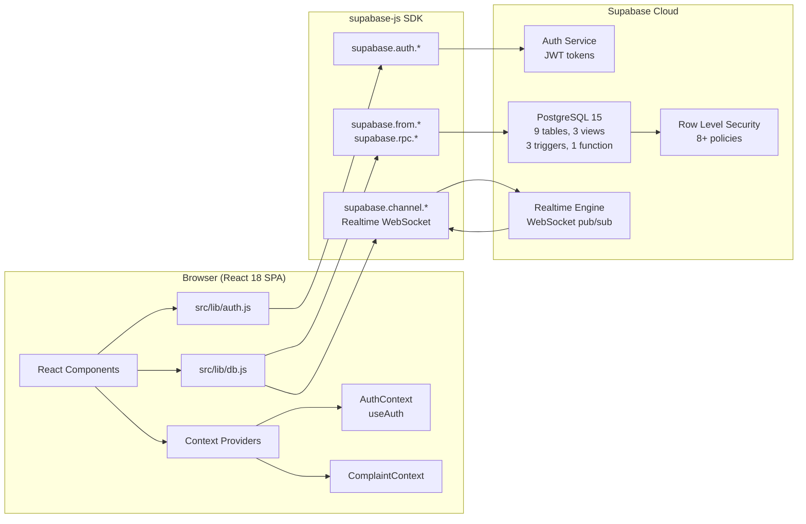

# 🏛️ Campus Complaint & Grievance Tracker

[](frontend/)
[](frontend/)
[](https://supabase.com)
[](https://www.postgresql.org/)
[](docs/Phase3_Normalization.pdf)
[](figma_wireframes/)

> **Database Management Systems (DBMS) Mini-Project — Final Submission Report**
> A multi-department campus grievance and complaint lifecycle management system for university students, hostel wardens, maintenance staff, and administration — built on a fully normalised PostgreSQL relational schema hosted on Supabase, with a modern React 18 single-page application front-end.

---

## 📋 Abstract

The Campus Complaint & Grievance Tracker is a web-based institutional complaint management system designed to streamline the lifecycle of student grievances across a multi-department university campus. The system provides a centralised platform where students can file, track, and receive real-time status updates on complaints spanning maintenance, hostel, academic, IT, and catering domains. At its core lies a fully normalised PostgreSQL 15 relational database (3NF) hosted on Supabase, featuring nine interrelated tables, three database views, three PL/pgSQL triggers, one stored function for SLA auto-escalation, eight composite indexes, and a comprehensive Row Level Security policy suite (8+ policies) enforcing role-based data isolation at the database layer. Four distinct user roles — Student, Staff, Warden, and Admin — operate through a React 18 single-page application connected via the Supabase JavaScript SDK, with JWT-based authentication, Realtime WebSocket subscriptions for live status changes, and a developer-facing SQL Query Inspector panel for academic demonstration of DBMS concepts.

---

## 👥 Team Members

| Member | Student Name | Roll No. | Email |
| :--- | :--- | :--- | :--- |
| **Member 1** | **Chirag Nikant Simepurushkar** | 24B-CO-015 | simepurushkarchirag84@gmail.com |
| **Member 2** | **Raksham R. Dessai** | 24B-CO-019 | rakshamdessai2006@gmail.com |
| **Member 3** | **Aayushi Rajesh Prabhu** | 24B-CO-001 | aayushiprabhu99@gmail.com |

---

## 📑 Table of Contents

1. [System Overview](#-system-overview)
2. [Tech Stack](#-tech-stack)
3. [Database Design](#-database-design)
   - [ER Diagrams](#71-er-diagrams)
   - [Entities](#72-entities)
   - [Relationships](#73-relationships)
   - [Schema Tables](#74-schema-tables)
   - [Normalization](#75-normalization--3nf)
4. [Key DBMS Concepts Implemented](#-key-dbms-concepts-implemented)
5. [Application Architecture](#-application-architecture)
6. [User Roles & Features](#-user-roles--features)
7. [SQL Queries Documentation](#-sql-queries-documentation)
8. [Developer SQL Query Inspector](#-developer-sql-query-inspector)
9. [Project Structure](#-project-structure)
10. [Setup & Running](#-setup--running)
11. [Supabase Configuration](#-supabase-configuration)
12. [Academic Documentation](#-academic-documentation)
13. [Git Branches](#-git-branches)
14. [Academic Attribution](#-academic-attribution)

---

## 🌐 System Overview

The Campus Complaint & Grievance Tracker is an end-to-end institutional grievance redressal platform. Students file complaints through a guided multi-step form; the system automatically routes them to the responsible department based on the selected category, tracks every status transition in an auditable history log, enforces SLA deadlines by auto-escalating overdue tickets, and surfaces real-time analytics to wardens and administrators.

### Four User Roles

| Role | Description |
|:---|:---|
| **Student** | Files complaints, tracks live status, views personal dashboard and history |
| **Staff** | Receives assigned tickets in a work queue, updates progress, marks resolved |
| **Warden** | Oversees all hostel-related complaints, monitors staff workload and SLA breaches |
| **Admin** | Full system access — assigns staff, manages categories/SLAs, views cross-department analytics |

### Key Features

- 📝 **Multi-step Complaint Filing** — Guided form with category, description, and automatic department routing
- 🔄 **Real-time Status Updates** — Supabase Realtime WebSocket subscriptions push live changes to all connected clients
- ⏱️ **SLA Enforcement** — Every category carries an `sla_days` threshold; a PL/pgSQL stored function (`escalate_overdue_complaints`) auto-escalates breached tickets
- 🔐 **Row Level Security** — 8+ PostgreSQL RLS policies enforce data isolation so each role sees only what they are authorised to see, enforced at the database layer
- 📊 **Analytics Dashboards** — Recharts-powered visualisations for complaint volume, resolution rates, staff workload, and monthly trends
- 🛠️ **Developer SQL Inspector** — DEV-ONLY floating panel that intercepts and displays every SQL query executed in real-time — built to showcase DBMS concepts during lab evaluation
- 📱 **22-Screen Figma Wireframes** — Full high-fidelity UI design system preceding implementation

---

## 🛠️ Tech Stack

| Layer | Technology | Version | Purpose |
|:---|:---|:---|:---|
| **Frontend Framework** | React | 18.x | Component-based SPA |
| **Build Tool** | Vite | 6.x | HMR dev server, optimised production build |
| **Styling** | TailwindCSS | 3.4 | Utility-first responsive CSS |
| **Animations** | Framer Motion | latest | Page transitions, micro-interactions |
| **Charts** | Recharts | latest | Analytics dashboards |
| **Routing** | React Router | 6.x | Client-side navigation |
| **Icons** | Lucide Icons | latest | Consistent icon set |
| **Database** | Supabase / PostgreSQL | 15+ | Relational DB with extensions |
| **DB Security** | Row Level Security (RLS) | — | Per-role data isolation at DB layer |
| **Realtime** | Supabase Realtime | — | WebSocket subscriptions on table changes |
| **Auth** | Supabase Auth | — | JWT-based email/password authentication |
| **SDK** | supabase-js | 2.x | Browser client for Supabase APIs |
| **Linting** | ESLint | latest | Code quality enforcement |

---

## 🗄️ Database Design

### 7.1 ER Diagrams

The project includes two complementary ER diagram representations, both located in the `images/` directory:

- **`images/main_er_diagram.svg`** — Scalable vector diagram showing both Chen notation (conceptual model) and Crow's Foot notation (logical model). Depicts all 8 entities, 7 relationships, the weak entity (`status_history`), the N:M junction (`staff_assignment`), and the multivalued attribute (`student_phone`).
- **`images/er diagram.jpeg`** — High-resolution raster version for printed submissions and presentations.
- **`docs/Phase2_ER_Modeling.pdf`** — Comprehensive academic ER modeling report with entity dictionary, relationship cardinality justifications, and participation constraints.
- **`docs/main ER_Document.pdf`** — Formal ER document submitted as Phase 2 deliverable.

```
Chen_ER_Diagram.jpg / main_er_diagram.svg
════════════════════════════════════════════════════════
 DEPARTMENT ──< EMPLOYS >── STAFF ──< WARDENS >── HOSTEL
      │                                               │
   OWNS                                           RESIDES_IN
      │                                               │
  CATEGORY ──< CLASSIFIED_AS >── COMPLAINT ──< FILES >── STUDENT
      │                              │
   SLA_Days                     ASSIGNED_TO (N:M)
                                     │
                                  STAFF_ASSIGNMENT
                                     │
                              LOGS (1:N weak)
                                     │
                              STATUS_HISTORY (weak entity)
```

---

### 7.2 Entities

| Entity | Type | Primary Key | Description |
|:---|:---|:---|:---|
| **Department** | Strong | `dept_id` (IDENTITY) | Academic/operational department (e.g., Estate & Maintenance, IT Services) |
| **Staff** | Strong | `staff_id` (IDENTITY) | University staff member; has `designation` used to derive role |
| **Hostel** | Strong | `hostel_id` (IDENTITY) | Student residential hostel; each has exactly one warden (1:1 with Staff) |
| **Student** | Strong | `student_id` (IDENTITY) | Enrolled student; resides in one hostel; has multivalued phone numbers |
| **Category** | Strong | `category_id` (IDENTITY) | Complaint category (e.g., Electrical, Plumbing); carries `sla_days` |
| **Complaint** | Strong | `complaint_id` (IDENTITY) | Core entity; has `status` domain type; references student + category |
| **StatusHistory** | **Weak Entity** | (`complaint_id`, `history_num`) | Identified by its owner Complaint; records every status transition |
| **StaffAssignment** | N:M Junction | (`staff_id`, `complaint_id`, `assigned_at`) | Resolves Many-to-Many between Staff and Complaint; has `unassigned_at` attribute |
| **StudentPhone** | Multivalued Attribute | (`student_id`, `phone_number`) | Represents the multivalued Phone_Numbers attribute of Student |

---

### 7.3 Relationships

| Relationship | Entities Involved | Cardinality | Participation | Key Constraint |
|:---|:---|:---|:---|:---|
| **Resides_In** | Student ↔ Hostel | N:1 | Student: Total | FK `hostel_id` on Student; ON DELETE RESTRICT |
| **Employs** | Department ↔ Staff | 1:N | Staff: Total | FK `dept_id` on Staff; ON DELETE RESTRICT |
| **Wardens** | Staff ↔ Hostel | 1:1 | Hostel: Total | FK `warden_id` on Hostel; UNIQUE constraint |
| **Files** | Student ↔ Complaint | 1:N | Complaint: Total | FK `student_id` on Complaint; ON DELETE RESTRICT |
| **Classified_As** | Category ↔ Complaint | 1:N | Complaint: Total | FK `category_id` on Complaint; ON DELETE RESTRICT |
| **Assigned_To** | Staff ↔ Complaint | **N:M** | Partial both sides | Resolved by `staff_assignment` junction table |
| **Logs** | Complaint ↔ StatusHistory | 1:N (identifying) | StatusHistory: Total | Weak entity; `complaint_id` part of PK; ON DELETE CASCADE |

---

### 7.4 Schema Tables

#### `department`
| Column | Type | Constraints |
|:---|:---|:---|
| `dept_id` | INTEGER | PRIMARY KEY, GENERATED BY DEFAULT AS IDENTITY |
| `dept_name` | TEXT | NOT NULL, UNIQUE |
| `dept_head` | TEXT | NOT NULL |

#### `staff`
| Column | Type | Constraints |
|:---|:---|:---|
| `staff_id` | INTEGER | PRIMARY KEY, GENERATED BY DEFAULT AS IDENTITY |
| `first_name` | TEXT | NOT NULL |
| `last_name` | TEXT | NOT NULL |
| `designation` | TEXT | NOT NULL (`'Admin'` → Admin role; `'Hostel Warden'` → Warden role) |
| `email` | TEXT | NOT NULL, UNIQUE |
| `dept_id` | INTEGER | FK → department(dept_id), ON UPDATE CASCADE, ON DELETE RESTRICT |

#### `hostel`
| Column | Type | Constraints |
|:---|:---|:---|
| `hostel_id` | INTEGER | PRIMARY KEY, GENERATED BY DEFAULT AS IDENTITY |
| `hostel_name` | TEXT | NOT NULL, UNIQUE |
| `warden_id` | INTEGER | NOT NULL, UNIQUE, FK → staff(staff_id), ON UPDATE CASCADE, ON DELETE RESTRICT |

#### `student`
| Column | Type | Constraints |
|:---|:---|:---|
| `student_id` | INTEGER | PRIMARY KEY, GENERATED BY DEFAULT AS IDENTITY |
| `first_name` | TEXT | NOT NULL |
| `last_name` | TEXT | NOT NULL |
| `email` | TEXT | NOT NULL, UNIQUE |
| `room_no` | TEXT | NOT NULL |
| `hostel_id` | INTEGER | FK → hostel(hostel_id), ON UPDATE CASCADE, ON DELETE RESTRICT |

#### `student_phone`
| Column | Type | Constraints |
|:---|:---|:---|
| `student_id` | INTEGER | FK → student(student_id), ON UPDATE CASCADE, ON DELETE CASCADE |
| `phone_number` | TEXT | CHECK regex `^[+]?[0-9]{10,15}$` |
| — | — | PRIMARY KEY (student_id, phone_number) |

#### `category`
| Column | Type | Constraints |
|:---|:---|:---|
| `category_id` | INTEGER | PRIMARY KEY, GENERATED BY DEFAULT AS IDENTITY |
| `category_name` | TEXT | NOT NULL, UNIQUE |
| `sla_days` | INTEGER | NOT NULL, CHECK (sla_days > 0) |
| `dept_id` | INTEGER | FK → department(dept_id), ON UPDATE CASCADE, ON DELETE RESTRICT |

#### `complaint`
| Column | Type | Constraints |
|:---|:---|:---|
| `complaint_id` | INTEGER | PRIMARY KEY, GENERATED BY DEFAULT AS IDENTITY |
| `description` | TEXT | NOT NULL, CHECK (length ≥ 10) |
| `status` | `complaint_status` | NOT NULL, DEFAULT `'Open'`; domain: `Open\|Assigned\|In-Progress\|Resolved\|Escalated` |
| `created_at` | TIMESTAMPTZ | NOT NULL, DEFAULT now() |
| `updated_at` | TIMESTAMPTZ | NOT NULL, DEFAULT now(), auto-updated by trigger |
| `student_id` | INTEGER | FK → student(student_id), ON UPDATE CASCADE, ON DELETE RESTRICT |
| `category_id` | INTEGER | FK → category(category_id), ON UPDATE CASCADE, ON DELETE RESTRICT |

#### `status_history` *(Weak Entity)*
| Column | Type | Constraints |
|:---|:---|:---|
| `complaint_id` | INTEGER | FK → complaint(complaint_id), ON UPDATE CASCADE, ON DELETE CASCADE |
| `history_num` | INTEGER | NOT NULL, CHECK (> 0); per-complaint sequence number |
| `old_status` | `complaint_status` | NULL for the first history row |
| `new_status` | `complaint_status` | NOT NULL |
| `changed_at` | TIMESTAMPTZ | NOT NULL, DEFAULT now() |
| — | — | PRIMARY KEY (complaint_id, history_num) — composite, identifying |

#### `staff_assignment` *(N:M Junction)*
| Column | Type | Constraints |
|:---|:---|:---|
| `staff_id` | INTEGER | FK → staff(staff_id), ON UPDATE CASCADE, ON DELETE RESTRICT |
| `complaint_id` | INTEGER | FK → complaint(complaint_id), ON UPDATE CASCADE, ON DELETE CASCADE |
| `assigned_at` | TIMESTAMPTZ | NOT NULL, DEFAULT now() |
| `unassigned_at` | TIMESTAMPTZ | NULL (NULL = currently active assignment) |
| — | — | PRIMARY KEY (staff_id, complaint_id, assigned_at) |
| — | — | UNIQUE INDEX `uq_active_assignment` WHERE unassigned_at IS NULL |

---

### 7.5 Normalization — 3NF

Full normalization documentation is in [`docs/Phase3_Normalization.pdf`](docs/Phase3_Normalization.pdf).

#### First Normal Form (1NF)
All attributes contain atomic values. The multivalued attribute `Phone_Numbers` from the ER model is extracted into the separate `student_phone` table with a composite primary key `(student_id, phone_number)`, eliminating repeating groups. No table contains arrays or sets.

#### Second Normal Form (2NF)
All non-key attributes in every table are **fully functionally dependent** on the entire primary key. In `staff_assignment`, the attributes `assigned_at` and `unassigned_at` describe the specific (staff, complaint, assigned_at) triple — not just one part of the key. `status_history.old_status` and `new_status` depend on the full composite key `(complaint_id, history_num)`.

#### Third Normal Form (3NF)
No transitive dependencies exist. For example, `dept_head` is stored in `department` (not in `staff` or `category`), so there is no path: `staff_id → dept_id → dept_head`. Similarly, `sla_days` lives in `category` (not in `complaint`), eliminating the transitive dependency `complaint_id → category_id → sla_days`. The domain type `complaint_status` further enforces value constraints at the schema level, replacing a lookup table while keeping the design clean.

---

## 🎓 Key DBMS Concepts Implemented

| Concept | Implementation | Location |
|:---|:---|:---|
| **Primary Keys** | IDENTITY-generated integer PKs on all 7 strong entity tables; composite PK on `status_history` and `staff_assignment` | All tables |
| **Foreign Keys with CASCADE/RESTRICT** | 11 FK relationships; `ON DELETE CASCADE` for weak entity rows; `ON UPDATE CASCADE` throughout; `ON DELETE RESTRICT` to prevent orphans | `01_schema_and_seed.sql` §1 |
| **Domain Type** | `CREATE DOMAIN public.complaint_status AS text CHECK (VALUE IN ('Open','Assigned','In-Progress','Resolved','Escalated'))` | §1 — before table creation |
| **Weak Entity** | `status_history` has no independent PK; identified by `(complaint_id, history_num)`; existence depends on `complaint` | Table §1.8 |
| **N:M Relationship** | `staff_assignment` resolves the Many-to-Many between Staff and Complaint with temporal attributes `assigned_at`/`unassigned_at` | Table §1.9 |
| **Derived Attribute** | `total_complaints_filed` = `COUNT(complaint_id)` computed live in `v_student_summary`; never stored | View §5 |
| **Views (3)** | `v_complaint_details` (security_invoker, 14 columns), `v_student_summary` (derived count), `v_staff_workload` (active/total assignments) | §5 |
| **Triggers (3)** | `trg_complaint_updated_at` (BEFORE UPDATE), `trg_complaint_status_log` (AFTER INSERT OR UPDATE → logs history), `trg_assignment_sets_status` (AFTER INSERT on assignment → auto-sets Assigned) | §4 |
| **Stored Function** | `escalate_overdue_complaints()` — PL/pgSQL CTE-UPDATE escalates Open/Assigned/In-Progress complaints past SLA_Days; returns count | §4.4 |
| **Row Level Security** | 8+ policies on all 9 tables; anon gets zero; students see own data; staff see department scope; admin sees all | §7 |
| **Referential Integrity** | All FK constraints enforced at DB level; `chk_description_len`, `chk_updated_after_created`, `chk_unassigned_after_assigned`, `chk_phone_format` CHECK constraints | §1 |
| **Indexes (8+)** | `idx_staff_dept`, `idx_student_hostel`, `idx_category_dept`, `idx_complaint_student`, `idx_complaint_category`, `idx_complaint_status`, `idx_complaint_created`, `idx_assignment_complaint`, `uq_active_assignment` (partial unique) | §2 |
| **Realtime Subscriptions** | `complaint` and `status_history` added to `supabase_realtime` publication; WebSocket channel in `src/lib/db.js` → `subscribeToComplaints()` | §8, `src/lib/db.js` |

---

## 🏗️ Application Architecture



**Data Flow:**
1. User logs in → `supabase.auth.signInWithPassword()` → Supabase issues JWT
2. JWT is attached automatically to every subsequent request by supabase-js
3. Queries hit PostgreSQL → RLS policies evaluate `auth.jwt() ->> 'email'` to enforce isolation
4. Status changes trigger `trg_complaint_status_log` → inserts into `status_history`
5. `supabase_realtime` publication broadcasts the change → browser WebSocket receives update → React state re-renders live

---

## 👤 User Roles & Features

### 🎓 Student
| Feature | Description |
|:---|:---|
| Registration & Login | Email/password auth via Supabase Auth; profile linked to `student` table by email |
| File New Complaint | Multi-step form; selects category → auto-routed to department; INSERT triggers history log |
| My Complaints | View own complaints via `v_complaint_details` (RLS: `student_id = current_student_id()`) |
| Complaint Detail | Full audit timeline from `status_history` (weak entity); SLA due date computed from `sla_days` |
| Live Status | Realtime WebSocket subscription updates status badge without page refresh |
| Student Dashboard | Personal stats: total filed, open, resolved, overdue counts from `v_student_summary` |

### 🔧 Staff
| Feature | Description |
|:---|:---|
| Staff Login | Supabase Auth; profile linked to `staff` table; role derived from `designation` field |
| My Work Queue | Active assignments via `staff_assignment JOIN complaint` where `unassigned_at IS NULL` |
| Update Status | UPDATE `complaint.status` → triggers `trg_complaint_status_log` automatically |
| Resolve Ticket | Sets status = `'Resolved'`; unsets assignment by updating `unassigned_at = now()` |
| Resolution History | Past assignments where `unassigned_at IS NOT NULL` |

### 🏠 Warden
| Feature | Description |
|:---|:---|
| Hostel Grievance Desk | All complaints for their hostel (`hostel_id` from warden's hostel record) |
| SLA Escalations | Filtered view of `is_overdue = true` from `v_complaint_details` |
| Staff Workload | `v_staff_workload` — active_assignments and total_assignments per staff member |
| Assign/Reassign Staff | INSERT into `staff_assignment` → `trg_assignment_sets_status` auto-updates complaint |

### 👑 Admin
| Feature | Description |
|:---|:---|
| Executive Dashboard | Cross-department complaint counts, SLA compliance, escalation rates |
| Department SLA Config | UPDATE `category.sla_days`; changes propagate to all future SLA calculations |
| Staff Roster & Matrix | Full staff list with workload from `v_staff_workload`; assign staff to any complaint |
| Analytical Reports | Recharts visualisations: by-category bar chart, status pie chart, monthly trend line |
| Run SLA Escalation | Calls `escalate_overdue_complaints()` RPC; returns count of newly escalated tickets |
| Full Data Access | RLS policies with `is_admin()` grant unrestricted SELECT/INSERT/UPDATE/DELETE |

---

## 📄 SQL Queries Documentation

### 1. Student Login Query

```sql
-- Auth layer: Supabase validates password and issues JWT
-- Then application fetches the student profile:
SELECT
  s.student_id,
  s.first_name,
  s.last_name,
  s.email,
  s.room_no,
  h.hostel_name,
  h.hostel_id
FROM public.student s
JOIN public.hostel h ON h.hostel_id = s.hostel_id
WHERE lower(s.email) = lower($1);   -- $1 = auth.jwt() ->> 'email'
```
> RLS on `student`: `USING (student_id = current_student_id() OR current_staff_id() IS NOT NULL)` — a student can only read their own row.

---

### 2. File Complaint (INSERT + Trigger Auto-Chain)

```sql
-- Step 1: Student inserts complaint (RLS checks student_id = current_student_id())
INSERT INTO public.complaint (description, student_id, category_id)
VALUES ($1, $2, $3)
RETURNING complaint_id, status, created_at;

-- Step 2: trg_complaint_status_log fires AFTER INSERT automatically:
--   INSERT INTO status_history (complaint_id, history_num, old_status, new_status, changed_at)
--   VALUES (NEW.complaint_id, 1, NULL, 'Open', NEW.created_at);
-- No application code needed for history — the trigger handles it.
```

---

### 3. View Own Complaints (via RLS-Enforced View)

```sql
-- v_complaint_details has security_invoker = true
-- So RLS on complaint applies when the view is queried
SELECT
  complaint_id, description, status,
  created_at, sla_due_at, is_overdue,
  category_name, handling_department,
  assigned_staff, hostel_name, room_no
FROM public.v_complaint_details
WHERE student_id = current_student_id()   -- enforced by RLS
ORDER BY created_at DESC;
```

---

### 4. Status History Timeline (Weak Entity Query)

```sql
-- Full audit trail for one complaint; history_num gives the sequence
SELECT
  sh.history_num,
  sh.old_status,
  sh.new_status,
  sh.changed_at,
  EXTRACT(EPOCH FROM (sh.changed_at - LAG(sh.changed_at) OVER
    (PARTITION BY sh.complaint_id ORDER BY sh.history_num))) / 3600
    AS hours_in_previous_state
FROM public.status_history sh
WHERE sh.complaint_id = $1
ORDER BY sh.history_num ASC;
```

---

### 5. Staff Assignment (N:M INSERT + Trigger)

```sql
-- Admin assigns a staff member to a complaint (N:M junction)
INSERT INTO public.staff_assignment (staff_id, complaint_id)
VALUES ($1, $2);

-- trg_assignment_sets_status fires AFTER INSERT:
--   UPDATE complaint SET status = 'Assigned'
--   WHERE complaint_id = NEW.complaint_id AND status = 'Open';
-- So the first assignment atomically moves status from Open → Assigned.

-- A staff member cannot hold the same complaint twice simultaneously:
-- UNIQUE INDEX uq_active_assignment ON staff_assignment (staff_id, complaint_id)
-- WHERE unassigned_at IS NULL   ← partial index
```

---

### 6. SLA Auto-Escalation (PL/pgSQL Stored Function)

```sql
-- Called from the app: supabase.rpc('escalate_overdue_complaints')
CREATE FUNCTION public.escalate_overdue_complaints() RETURNS integer
LANGUAGE plpgsql SECURITY DEFINER SET search_path = public AS $$
DECLARE
  v_count integer;
BEGIN
  WITH escalated AS (
    UPDATE public.complaint c
       SET status = 'Escalated'
      FROM public.category cat
     WHERE cat.category_id = c.category_id
       AND c.status IN ('Open', 'Assigned', 'In-Progress')
       AND c.created_at + (cat.sla_days * INTERVAL '1 day') < now()
     RETURNING c.complaint_id
  )
  SELECT COUNT(*) INTO v_count FROM escalated;
  RETURN v_count;   -- number of tickets escalated this run
END;
$$;
```
> The trigger `trg_complaint_status_log` fires for each escalated row, writing a `StatusHistory` record automatically.

---

### 7. Admin Analytics Aggregates

```sql
-- Dashboard counters
SELECT
  COUNT(*)                                            AS total_complaints,
  COUNT(*) FILTER (WHERE status = 'Open')             AS open_count,
  COUNT(*) FILTER (WHERE status = 'Assigned')         AS assigned_count,
  COUNT(*) FILTER (WHERE status = 'In-Progress')      AS in_progress_count,
  COUNT(*) FILTER (WHERE status = 'Resolved')         AS resolved_count,
  COUNT(*) FILTER (WHERE status = 'Escalated')        AS escalated_count,
  COUNT(*) FILTER (WHERE is_overdue = true)           AS overdue_count
FROM public.v_complaint_details;

-- Complaints by category (bar chart data)
SELECT cat.category_name, COUNT(c.complaint_id) AS total
FROM public.complaint c
JOIN public.category cat ON cat.category_id = c.category_id
GROUP BY cat.category_name
ORDER BY total DESC;

-- Monthly trend (line chart data)
SELECT
  date_trunc('month', created_at) AS month,
  COUNT(*)                        AS complaints
FROM public.complaint
GROUP BY month
ORDER BY month;
```

---

### 8. RLS Policy Example

```sql
-- How Supabase enforces data isolation for complaints:

-- Students can INSERT only their own complaints, only with status='Open'
CREATE POLICY complaint_student_insert ON public.complaint
  FOR INSERT TO authenticated
  WITH CHECK (
    student_id = public.current_student_id()
    AND status = 'Open'
  );

-- Auth helper (runs with SECURITY DEFINER, reads JWT):
CREATE FUNCTION public.current_student_id() RETURNS integer
LANGUAGE sql STABLE SECURITY DEFINER SET search_path = public AS $$
  SELECT s.student_id
  FROM public.student s
  WHERE lower(s.email) = lower(auth.jwt() ->> 'email')
  LIMIT 1;
$$;
```

---

## 🔍 Developer SQL Query Inspector

The application includes a **DEV-ONLY floating panel** (`src/components/dev/`) designed specifically to showcase DBMS concepts during lab evaluation.

### What It Does

When running in development mode (`import.meta.env.DEV === true`), a floating translucent drawer appears in the bottom-right corner of every page. It intercepts the supabase-js client and logs **every SQL query executed** in real-time, including:

- The raw SQL or RPC call name
- Parameters / filters applied
- Which RLS policy governs the result
- Response time in milliseconds
- Row count returned

### Why It Exists

This panel was built as an **academic demonstration tool** — it makes visible the normally-invisible database layer, allowing evaluators to verify that:

1. Correct SQL is generated for each user action
2. RLS is active (different users get different result sets for the same query)
3. Triggers fire automatically (a complaint INSERT shows a follow-up `status_history` INSERT)
4. The SLA function returns the escalation count

### How to Use

1. Run `npm run dev` (panel is hidden in production builds)
2. Click the **"SQL"** badge in the bottom-right corner
3. Perform any action (login, file complaint, change status)
4. Watch the query log update in real-time

> **Note:** The Dev Inspector is stripped from production builds via Vite's `import.meta.env.DEV` flag. It is purely an academic showcase feature.

---

## 📁 Project Structure

```plaintext
campus-complaint-tracker/
├── README.md                               ← This file (Full Project Report)
├── docs/                                   ← Academic Submission Deliverables
│   ├── Campus Complaint & Grievance Tracker.pdf  ← Combined report PDF
│   ├── Campus_Complaint_Tracker.pptx       ← Defense presentation slides
│   ├── Complete_Execution_Plan.pdf         ← Timeline & sprint breakdown
│   ├── main_ER_Document.docx               ← Editable ER report source
│   ├── main ER_Document.pdf                ← Phase 2 ER formal document
│   ├── main Project_Synopsis.pdf           ← Project abstract & scope
│   ├── main Requirement_Analysis_DBMS.pdf  ← Functional & non-functional requirements
│   ├── Phase2_ER_Modeling.pdf              ← Phase 2 entity-relationship diagrams
│   └── Phase3_Normalization.pdf            ← Phase 3 relational mapping & 3NF validation
├── figma_wireframes/                        ← 22 High-Fidelity SVG Wireframes
│   ├── 01_Welcome_Gateway.svg
│   ├── 02_Student_Login_Register.svg
│   ├── 04_Student_Dashboard.svg
│   ├── 05_File_New_Complaint.svg
│   ├── 08_Complaint_Detail_View.svg
│   ├── 09_Live_Status_Timeline.svg
│   ├── 10_Staff_Queue_Dashboard.svg
│   ├── 14_Warden_Hostel_Dashboard.svg
│   └── 18_Admin_Executive_Dashboard.svg
├── images/                                  ← ER Diagram Images
│   ├── main_er_diagram.svg                  ← Scalable Chen & Crow's Foot ER diagrams
│   └── er diagram.jpeg                      ← High-resolution raster diagram
├── MySQL/                                   ← MySQL Reference SQL (for DBMS lab docs)
│   ├── 01_schema_and_seed.sql               ← PostgreSQL/Supabase production schema
│   └── campus_complaint_tracker.sql         ← MySQL documentation & query showcase
└── frontend/                                ← React 18 + Vite SPA
    ├── .env.example                         ← Template — copy to .env and fill values
    ├── .env                                 ← Local env (gitignored): Supabase URL & key
    ├── index.html
    ├── package.json
    ├── tailwind.config.js
    ├── vite.config.js
    └── src/
        ├── main.jsx                         ← React entry point; wraps with AuthProvider
        ├── App.jsx                          ← Router, layout shells, protected routes
        ├── index.css                        ← Tailwind directives
        ├── lib/                             ← Supabase client & data access layer
        │   ├── supabase.js                  ← createClient() with env vars
        │   ├── auth.js                      ← studentSignIn, staffSignIn, signOut, getSession
        │   └── db.js                        ← All DB query functions; RPC calls; realtime
        ├── context/                         ← React context providers
        │   ├── AuthContext.jsx              ← Session, user, profile, role state
        │   ├── ComplaintContext.jsx         ← Complaints state, CRUD actions, realtime
        │   └── ToastContext.jsx             ← Toast notification system
        ├── components/
        │   ├── common/                      ← Shared UI components
        │   │   ├── Navbar.jsx               ← Real auth user display + sign out
        │   │   ├── Sidebar.jsx              ← Role-based navigation (useAuth)
        │   │   ├── CampusLogo.jsx
        │   │   ├── StatusBadge.jsx
        │   │   └── NotificationsDrawer.jsx
        │   └── dev/                         ← DEV-ONLY components (hidden in production)
        │       └── SqlQueryInspector.jsx    ← Floating real-time SQL query panel
        └── pages/                           ← Route-level page components
            ├── WelcomeGateway.jsx           ← Public landing page
            ├── StudentAuth.jsx              ← Student login/register
            ├── StaffAdminAuth.jsx           ← Staff/Warden/Admin login
            ├── StudentDashboard.jsx         ← Student home with stats
            ├── FileComplaint.jsx            ← Multi-step complaint filing form
            ├── MyComplaints.jsx             ← Student complaint list
            ├── ComplaintDetail.jsx          ← Detail + status history timeline
            ├── ComplaintSuccess.jsx         ← Post-submit confirmation
            ├── LiveStatusTimelinePage.jsx   ← Animated status tracker
            ├── StaffQueueDashboard.jsx      ← Staff assigned ticket queue
            ├── StaffTicketAction.jsx        ← Staff status update form
            ├── StaffHistory.jsx             ← Staff resolution history
            ├── WardenHostelDashboard.jsx    ← Warden complaint overview
            ├── WardenEscalations.jsx        ← SLA breach list
            ├── WardenStaffWorkload.jsx      ← Staff workload table
            ├── AdminDashboard.jsx           ← Executive overview
            ├── AdminSlaConfig.jsx           ← SLA management
            ├── AdminStaffRoster.jsx         ← Staff assignment matrix
            └── AdminAnalytics.jsx           ← Charts & analytics
```

---

## 🚀 Setup & Running

### Step 1 — Clone the Repository

```bash
git clone https://github.com/RakshamDessai/campus-complaint-tracker.git
cd campus-complaint-tracker
```

### Step 2 — Create a Supabase Project

1. Go to [supabase.com](https://supabase.com) and sign in
2. Click **New Project**
3. Choose a region close to your location
4. Note down your **Project URL** and **anon public key** from:
   > Dashboard → Settings → API → Project URL & Project API Keys

### Step 3 — Run the Schema SQL

1. In your Supabase Dashboard, go to **SQL Editor → New Query**
2. Paste the entire contents of [`MySQL/01_schema_and_seed.sql`](MySQL/01_schema_and_seed.sql)
3. Click **Run** — this creates all 9 tables, 3 views, 3 triggers, 1 stored function, 8+ indexes, all RLS policies, and inserts seed data

Expected output (verify with the final SELECT):
```
department    | 5 rows
staff         | 9 rows
hostel        | 3 rows
student       | 10 rows
student_phone | 13 rows
category      | 8 rows
complaint     | 14 rows
status_history| 36 rows
staff_assignment | 12 rows
```

### Step 4 — Create Auth Users in Supabase Dashboard

Go to **Dashboard → Authentication → Users → Add User** and create these users (email must match seed data exactly):

| Role | Email | Password (suggested) |
|:---|:---|:---|
| **Admin** | `rajesh.gawas@campus.edu` | `Admin@1234` |
| **Warden (Mandovi)** | `sunita.borkar@campus.edu` | `Warden@1234` |
| **Warden (Zuari)** | `prakash.fernandes@campus.edu` | `Warden@1234` |
| **Warden (Chapora)** | `kavita.shetty@campus.edu` | `Warden@1234` |
| **Staff — Electrician** | `anil.pai@campus.edu` | `Staff@1234` |
| **Staff — Plumber** | `joseph.dias@campus.edu` | `Staff@1234` |
| **Staff — Network** | `neha.kamat@campus.edu` | `Staff@1234` |
| **Student 1** | `raksham.dessai@campus.edu` | `Student@1234` |
| **Student 2** | `aarav.naik@campus.edu` | `Student@1234` |
| **Student 3** | `ananya.prabhu@campus.edu` | `Student@1234` |

> The application matches `auth.jwt() ->> 'email'` against `student.email` and `staff.email` to derive the user's role and profile automatically.

### Step 5 — Create `.env` File

```bash
cd frontend
cp .env.example .env
```

Edit `.env`:
```env
VITE_SUPABASE_URL=https://your-project-ref.supabase.co
VITE_SUPABASE_ANON_KEY=your-anon-key-here
```

Replace with the values from your Supabase Dashboard → Settings → API.

### Step 6 — Install Dependencies

```bash
# In the frontend/ directory
npm install
```

### Step 7 — Start Development Server

```bash
npm run dev
```

### Step 8 — Open in Browser

```
http://localhost:5173
```

### Step 9 — Login with Seed Credentials

| Portal | Email | Password |
|:---|:---|:---|
| Student Portal | `raksham.dessai@campus.edu` | `Student@1234` |
| Student Portal | `ananya.prabhu@campus.edu` | `Student@1234` |
| Staff Desk | `anil.pai@campus.edu` | `Staff@1234` |
| Staff Desk | `neha.kamat@campus.edu` | `Staff@1234` |
| Warden Desk | `sunita.borkar@campus.edu` | `Warden@1234` |
| Admin Portal | `rajesh.gawas@campus.edu` | `Admin@1234` |

---

## ⚙️ Supabase Configuration

### Row Level Security (RLS)

RLS is enabled on **all 9 tables**. The `anon` role is completely revoked — unauthenticated visitors get zero data. After login, Supabase issues a JWT containing the user's email, which the helper functions (`current_student_id()`, `current_staff_id()`, `is_admin()`) use to enforce per-row access control.

```sql
-- Example: a student can only read their own student row
CREATE POLICY student_read ON public.student
  FOR SELECT TO authenticated
  USING (
    student_id = public.current_student_id()
    OR public.current_staff_id() IS NOT NULL
  );
```

Column-level grants further restrict what authenticated users can write:
```sql
GRANT INSERT (description, student_id, category_id) ON public.complaint TO authenticated;
GRANT UPDATE (status, category_id)                  ON public.complaint TO authenticated;
-- Students cannot touch complaint_id, created_at, updated_at
```

### Authentication Setup

Supabase Auth is configured with the **Email** provider. The application uses `supabase.auth.signInWithPassword()` for login and `supabase.auth.signUp()` for student self-registration. JWT tokens are automatically managed by the supabase-js SDK and injected into every request header.

Role derivation happens client-side after login:
1. Check if email exists in `student` table → role = `'Student'`
2. Else check `staff` table → read `designation`:
   - `'Admin'` → role = `'Admin'`
   - Contains `'Warden'` → role = `'Warden'`
   - Otherwise → role = `'Staff'`

### Realtime Subscriptions

The `complaint` and `status_history` tables are added to the `supabase_realtime` Postgres publication. To enable in Supabase Dashboard:

1. Go to **Database → Replication**
2. Enable Replication for the `complaint` table
3. Enable Replication for the `status_history` table

The application subscribes via:
```js
supabase
  .channel('complaint-changes')
  .on('postgres_changes', { event: 'UPDATE', schema: 'public', table: 'complaint' }, callback)
  .subscribe();
```

---

## 📚 Academic Documentation

All official submission documents are in the [`docs/`](docs/) folder:

| Document | Description |
|:---|:---|
| [`Campus Complaint & Grievance Tracker.pdf`](docs/) | Comprehensive combined project report |
| [`main Project_Synopsis.pdf`](docs/) | Project abstract, problem definition, scope, and objectives |
| [`main Requirement_Analysis_DBMS.pdf`](docs/) | Functional requirements (use cases) and non-functional requirements |
| [`main ER_Document.pdf`](docs/) | Formal ER modeling document — entity dictionary, relationship types, cardinality |
| [`main_ER_Document.docx`](docs/) | Editable Word source for the ER document |
| [`Phase2_ER_Modeling.pdf`](docs/) | Phase 2 deliverable — full ER diagram set with Chen notation |
| [`Phase3_Normalization.pdf`](docs/) | Phase 3 deliverable — relational mapping, functional dependencies, 1NF/2NF/3NF proof |
| [`Campus_Complaint_Tracker.pptx`](docs/) | Official team defense presentation (22 slides) |
| [`Complete_Execution_Plan.pdf`](docs/) | Sprint timeline, task breakdown, and deliverable schedule |

---

## 🌿 Git Branches

| Branch | Purpose |
|:---|:---|
| `main` | Evaluated submission deliverables, documentation, ER diagrams, presentation slides |
| `develop` | Shared integration branch for team features |
| `frontend` | React 18 + Vite SPA workspace |
| `backend` | Database and backend development workspace |

---

## 📄 Academic Attribution

This project was developed for academic evaluation in the **Department of Computer Engineering** as part of the **Database Management Systems (DBMS)** mini-project curriculum.

**Institution:** Government Engineering College (GEC)  
**Academic Year:** 2026  
**Subject:** Database Management Systems  
**Project Phase:** Final Submission  

All rights reserved © 2026 Chirag Simepurushkar, Raksham Dessai, Aayushi Prabhu.

> This system was built for educational purposes to demonstrate relational database design principles, normalisation, SQL programming, and modern full-stack integration with a cloud-hosted RDBMS.
